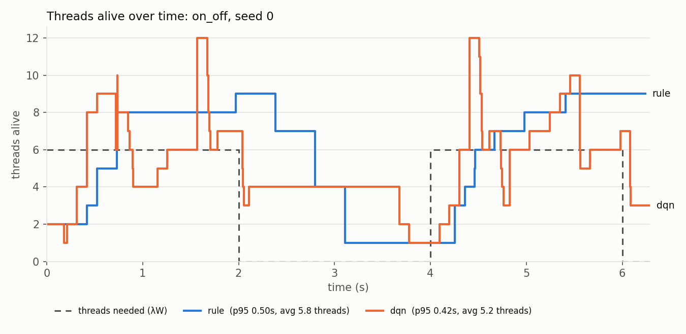
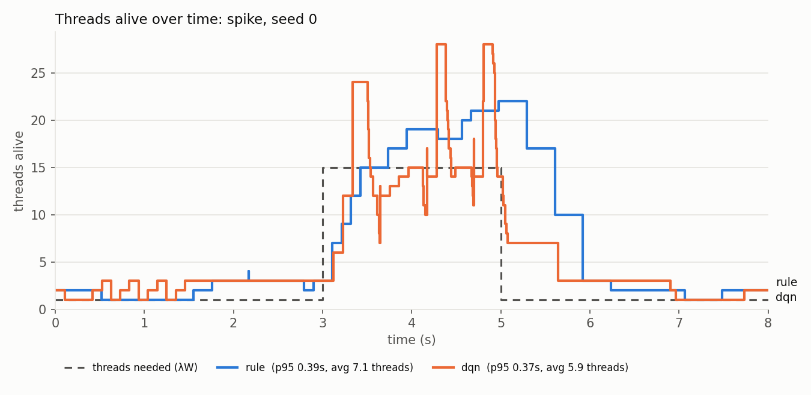

# ATPS: Adaptive Thread Pool Sizing

A Python thread pool that resizes itself while it runs. 

A controller watches live stats (arrival rate, service time, queue length) and picks the pool size for the next interval, aiming for a low tail latency without paying for idle threads.

Choosing a pool size is a trade-off. Too few threads causes tasks to queue, so p95 latency climbs. Too many causes idle threads that you pay for. The right size changes as the load changes, so a fixed `max_workers` is either too small at peak or wasteful the rest of the time.


## How it works

```
workload ──submit──▶ pool (shared queue + worker threads) ──▶ stats
                        ▲                                      │
                        └──── resize ◀── controller ◀──────────┘
                              (control loop, every 100 ms)
```

- **Pool** (`atps/pool.py`): Is a `concurrent.futures.Executor` with one shared queue. It starts up new threads to grow. It shrinks by queuing one "poison pill" per retiring thread, and the worker that picks it up exits after finishing its current task (no task is ever cut off)
- **Stats** (`atps/stats.py`): Records the submitted, started and finished times for every task, giving a windowed snapshot of arrival rate, mean service time and p95 latency.
- **Controllers** (`atps/controllers.py`): An interface `decide(snapshot, num_workers, queue_length) -> int`. Every controller is a pure function of the stats, so they're tested without threads.
  - `FixedController(n)`: The baseline
  - `RuleController`: Little's Law plus headroom plus a backlog term:

    **target = ⌈ λ·W·(1 + h) + Q·W / D ⌉**

    λ·W is the average number of busy threads (Little's Law). The headroom h=0.25 keeps workers no more than 80% busy. Q·W/D adds enough threads to clear the current queue within D seconds. 
  The pool grows immediately but is only allowed to shrink after 3 low readings in a row, because too few threads hurts users at once unlike too many which only costs a little.
  - `DQNController` (`atps/dqn.py`, `atps/mdp.py`): a Deep Q-Network trained against the real pool, following the PyTorch DQN tutorial (replay memory, target network, epsilon-greedy exploration).
    - **Actions:** halve, −1, hold, +1, double (kept within 1..64).
    - **State:** pool size, queue length, p95 latency, Little's Law's λ·W, and threads actually alive, all normalised. λ·W is in the state because the reward depends on it. Without it, the agent can't tell "8 threads at 70 tasks/s" from "8 threads at 10 tasks/s".
    - **Reward:** −p95 − 0.02 × (threads *alive* above ⌈λ·W·1.25⌉). Too few threads already shows up in p95, so only the threads *above* the Little's Law target are charged; one wasted thread costs as much as 20 ms of p95.
    - Trained for 100 episodes (~15 min) on seeds 1000+; evaluated on seeds 0–2, which it never saw.
- **Control loop** (`atps/loop.py`): A background thread that runs one tick per interval. It uses `Event.wait` rather than `sleep`, so shutdown stops it at once.

Tasks are I/O-bound (`time.sleep`), which releases the GIL. CPU-bound work wouldn't benefit from more threads in standard CPython, so it's out of scope.

## Evaluation

Each scenario is a seeded Poisson arrival process with exponential service times (mean 100 ms). 
Every controller gets **exactly the same task list** for a given seed. 
Tasks are submitted **open-loop**, at their scheduled times whether or not the pool keeps up, so an undersized pool can't slow the arrivals down and hide its overload.

| Scenario | Load |
|---|---|
| steady | 40 tasks/s for 8 s |
| spike | 10/s, then 150/s for 2 s, then 10/s |
| ramp | 5 → 80 tasks/s over 8 s |
| on_off | 60/s for 2 s, idle for 2 s, repeated |

The rule controller is able to see the queue length- the same input the DQN gets- so any DQN success comes from the policy and not from extra information. `rule-noqueue` is an ablation which omits the backlog term.

### Results

Mean p95 latency in seconds over 3 seeds (Apple M4, Python 3.14). [brackets show the average number of threads alive].

| Scenario | fixed-4 | fixed-16 | rule | rule-noqueue | dqn |
|---|---|---|---|---|---|
| steady | 0.73 (4) | 0.32 (16) | 0.38 (5.7) | 0.43 (5.5) | **0.36** (4.7) |
| spike | 5.93 (4) | 0.35 (16) | 0.42 (7.3) | 0.53 (6.8) | **0.40** (6.0) |
| ramp | 2.61 (4) | 0.31 (16) | **0.35** (5.7) | 0.36 (5.6) | 0.37 (4.8) |
| on_off | 1.38 (4) | 0.33 (16) | 0.52 (5.9) | 0.65 (5.4) | **0.40** (5.3) |

- The rule controller's p95 is within 0.03–0.19 s of fixed-16 while using **36–45% of the threads**.
- Fixed-4 collapses under the spike (5.9 s p95). Once the queue builds, it can't catch up.
- The backlog term (Q·W/D) cuts p95 by about 25% on the bursty scenarios, for about 0.5 extra threads.
- **The DQN uses 12–18% fewer threads than the rule on every scenario.** Its clear win is `on_off`: 0.40 s vs 0.52 s, the rule's weakest scenario. On `steady` (0.36 vs 0.38) and `spike` (0.40 vs 0.42) its p95 edge is inside the rule's seed-to-seed spread (±0.06–0.07), so call those a tie on latency and a win on threads.
- **Where the DQN loses:** `ramp`, 0.37 s vs the rule's 0.35 s. It saves 16% of the threads, but pays for it in latency.



The plots show threads actually alive (a separate run of seed 0, so the numbers differ slightly from the table). On `on_off` the rule steps up slowly at the start of each burst, because λ is a 1-second average and lags, then holds for several ticks before shrinking, and ends the second burst at 9 threads for a load that needs 6. The DQN grows within a tick or two, keeps about 4 threads warm through most of the idle gap, and lets go as soon as the second burst ends. It is also much jumpier: it resizes almost every tick, which the reward doesn't penalise, however could create overhead costs at scale.



On `spike` the rule was expected to lag, because its λ is a 1-second trailing average. It doesn't however, at least not when growing- both controllers reach ~15 threads within about 0.4 s of the spike starting. The backlog term (Q·W/D) sees the queue at once and covers for the lagging λ. The real difference is at the end of the spike. The rule overshoots to ~22 threads and takes about a second to come back down (the 1-second λ window plus 3 low ticks before shrinking), while the DQN mostly sits near the 15 needed, with brief doublings that drain away, and drops straight away when the spike ends. That's where its thread savings come from, not from reacting faster.

### The DQN gamed the initial rewarding mechanism

The first version charged the DQN for `num_workers`, the pool's *target* size. A shrink queues a poison pill at the back of the queue, so during a burst a "retired" thread keeps working until it reaches its pill, while `num_workers` already counts it as gone. The DQN found this: it halved and doubled every tick, so its measured cost dropped while the retiring threads kept the latency down. During the spike its reported size averaged 13.2 threads while 15.1 were really alive (12.6 vs 15.5 on a 10-second spike).

I spotted this because the DQN seemed to run below Little's Law's 15 threads for most of a spike without its latency suffering, which shouldn't be possible. The fix was to measure what actually costs: the pool now logs threads alive which the metric, plots and reward all use now. After retraining, the DQN still uses 12–18% fewer threads than the rule, and its halve/double sawtooth during bursts turned into occasional doublings that drain away. The table above is the fixed version.

Comparisons between controllers are the focus here, absolute numbers are machine-dependent.
Full per-run data: [`results/eval.csv`](results/eval.csv). 

## Run it

Requires Python 3.12+. The pool, rule controller and evaluation use only the standard library. The DQN needs `torch`, the plot needs `matplotlib`, and the tests need `pytest`.

```bash
python -m pytest -q                       # 70 tests
python -m atps.train --episodes 100       # trains models/dqn.pt (~15 min; a trained model is included)
python -m atps.evaluate --seeds 3         # writes results/eval.csv (~9 min)
python -m atps.plot --scenario on_off     # writes results/pool_size_on_off.png (also: --scenario spike)
```

<!--```python
from atps.pool import AdaptiveThreadPoolExecutor
from atps.controllers import RuleController

with AdaptiveThreadPoolExecutor(initial_workers=2, controller=RuleController()) as pool:
    future = pool.submit(fetch, url)
```-->

## Limitations

- If a controller raises an exception, the control loop thread stops and the pool stays at its last size.
- At the very start of a burst there's no service-time data yet, so the rule holds instead of growing.
- Python's GIL means this only helps I/O-bound work.
- Results come from simulated I/O (`sleep`), not real network calls.
- The DQN result comes from **one training run**. A different training seed could give a better or worse agent; training several and reporting the spread would be the rigorous version.
- The test seeds are new random draws of the **same four scenario shapes** the DQN trained on. It hasn't been tested on a kind of load it never saw (e.g. train on three scenarios, test on the fourth).
- The DQN resizes almost every tick. Real threads are cheap to start here, but a resize penalty in the reward would be needed where they aren't.
- The reward treats "no completed tasks in the window" as zero latency. That's right when the pool is idle, and holds here because tasks take ~100 ms; with multi-second tasks it would need a queue-length penalty.


May be developed to include free-threaded Python 3.14t for CPU-bound work readings

`experiment/` holds the original December 2025 prototype, kept for history.
